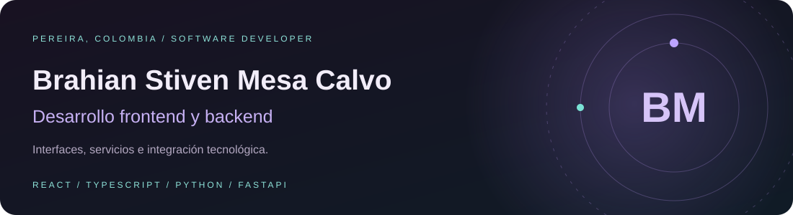
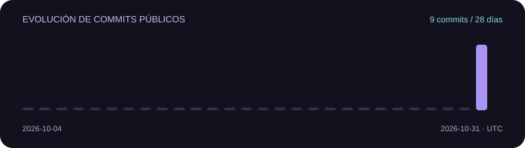

**Desarrollo interfaces y servicios que conectan aplicaciones, datos y dispositivos.**

[LinkedIn](https://www.linkedin.com/in/brahianstivenmesadev/) · [Correo](mailto:brastivmesa@gmail.com) · [Portafolio y código](https://github.com/brahian-mesa/portfolio)

[Sobre mí](#sobre-mí) · [Tecnologías](#tecnologías) · [Proyectos](#proyectos) · [Commits](#actividad-y-commits) · [Contacto](#contacto)

## Sobre mí

Soy **Brahian Stiven Mesa Calvo**, de **Pereira, Risaralda, Colombia**. Mi enfoque está en el **desarrollo frontend y backend**, con proyectos web, aplicaciones móviles e integración IoT.

Busco oportunidades para aportar en equipos que desarrollen interfaces, APIs y aplicaciones de gestión. En **EnerMind** he trabajado principalmente en backend, con aportes en frontend e IoT. En **VencIA** y **FrancentrIA** he participado en frontend y backend.

<b>Conoce mi formación y lo que estoy aprendiendo</b>

- **Formación:** Tecnología en Desarrollo de Software, Universidad Católica · 2024–2026.
- **Proyecto de grado:** EnerMind, monitoreo energético inteligente.
- **Áreas de aprendizaje:** arquitectura backend, integración IoT, Docker, automatización y sistemas distribuidos.
- **Inglés:** A2, en formación.

## Tecnologías

  

<b>Frontend y aplicaciones móviles</b>

React · JavaScript · TypeScript · Tailwind CSS · Vite · React Native · Expo · Zustand

<b>Backend y datos</b>

Python · FastAPI · Node.js · Express · Java · Spring Boot · APIs REST · WebSocket · MySQL · PostgreSQL

<b>Herramientas e integración IoT</b>

Git · GitHub · Docker · Linux · MQTT · ESP32 · PlatformIO

## Proyectos

### EnerMind

Monitoreo energético industrial y proyecto de grado. Integra una API, una aplicación móvil y firmware para ESP32.

**Mi participación:** principalmente backend, con aportes en frontend e integración IoT.

**Tecnologías del proyecto:** Python, FastAPI, scikit-learn, React Native, Expo, TypeScript, Zustand, ESP32, PlatformIO y MQTT.

<b>Explorar los tres componentes de EnerMind</b>

- **API:** recepción de mediciones por MQTT, consulta REST/WebSocket, detección de anomalías y proyección de consumo. [enermind-api](https://github.com/Enermind-energy/enermind-api)
- **App:** pantallas de consumo, dispositivos, análisis y alertas. [enermind-app](https://github.com/Enermind-energy/enermind-app)
- **Firmware:** ESP32 con sensor PZEM-004T, pantalla OLED, Wi-Fi y MQTT. [firmware-enermind](https://github.com/brahian-mesa/firmware-enermind)

Los tres repositorios son privados y requieren autorización de acceso.

### VencIA co

Aplicación para contadores colombianos, con gestión de clientes, obligaciones y calendario de vencimientos documentados en el proyecto.

**Mi participación:** frontend y backend. **Tecnologías:** Expo, React Native y TypeScript.

[Ver repositorio VencIA](https://github.com/brahian-mesa/VencIA) · Privado

### FrancentrIA

Control de asistencia mediante reconocimiento facial. Sus repositorios documentan API, servicios de inteligencia artificial, aplicación móvil y panel administrativo.

**Mi participación:** frontend y backend.

[Backend](https://github.com/brahian-mesa/FrancentrIA) · [Frontend](https://github.com/brahian-mesa/FrancentrIA-Frontend) · Repositorios privados

<b>Ver otros desarrollos web y backend</b>

- **Sistema de asistencia y materias:** pantallas de materias, asistencia, notas y calendario escolar. React y Vite. [Código público](https://github.com/brahian-mesa/sistemaNotasAsistencia)
- **GnosisNancy:** interfaz de tesorería con personas, pagos, reporte mensual, historial y exportación. React, Vite y Tailwind CSS. [Código privado](https://github.com/brahian-mesa/GnosisNancy)
- **UrbanPass Backend:** autenticación, usuarios, rutas y servicios documentados. Java, Spring Boot, MySQL y JWT. [Código público](https://github.com/brahian-mesa/Backend-UrbanPass)
- **Urban Pass:** proyecto web con instrucciones de instalación de componentes de interfaz. [Código privado](https://github.com/brahian-mesa/Urban_Pass)
- **Sistema de Admisiones:** proyecto con dependencias de Node.js y Express. [Código público](https://github.com/brahian-mesa/Sistema-Admisiones)

## Actividad y commits

Aquí puedes seguir cambios reales y abrir cada commit para ver su diferencia de código. Esta sección se actualiza diariamente mediante GitHub Actions.

<!-- ACTIVITY:START -->
**9 commits públicos** · 2026-10-04 → 2026-10-31 (UTC)

**Últimos cambios**

- `2026-10-31` · [5be2a35](https://github.com/brahian-mesa/portfolio/commit/5be2a3588fadc5584ba0b41838dab8be25d10507) · **brahian-mesa/portfolio** — style: remove decorative star symbols
- `2026-10-31` · [7500c6f](https://github.com/brahian-mesa/portfolio/commit/7500c6fddde4b8bd07f1161613a129fbab6abbb8) · **brahian-mesa/portfolio** — feat: add persistent light and dark theme toggle
- `2026-10-31` · [027ce08](https://github.com/brahian-mesa/portfolio/commit/027ce085f72fded32a7e5102b4a3addb3cb407ba) · **brahian-mesa/portfolio** — feat: add Motion interactions and Lucide icons
- `2026-10-31` · [e35c262](https://github.com/brahian-mesa/portfolio/commit/e35c2629347aaf0aa032bf5eac9c0d3a70294845) · **brahian-mesa/portfolio** — feat: redesign portfolio with animated sections and verified profile
- `2026-10-31` · [71f3dcc](https://github.com/brahian-mesa/portfolio/commit/71f3dcc9d2ace75cd837e6a5d04f563ec5ee0d8c) · **brahian-mesa/portfolio** — feat: add bilingual about me section and navigation
- `2026-10-31` · [0e40fa8](https://github.com/brahian-mesa/portfolio/commit/0e40fa87961eafbb0a3127c716001203998091ca) · **brahian-mesa/portfolio** — fix: use confirmed sistemaNotasAsistencia repository

Solo repositorios públicos propios y sus ramas predeterminadas. Se excluyen bots, forks y repositorios archivados. Los commits privados y los de organizaciones no forman parte de esta gráfica.

[Ver contribuciones del perfil](https://github.com/brahian-mesa?tab=overview) · [Historial del portafolio](https://github.com/brahian-mesa/portfolio/commits/main/)
<!-- ACTIVITY:END -->

<b>Ver cómo ha evolucionado mi portafolio</b>

Cada paso está enlazado con un commit real:

1. **Catálogo bilingüe con proyectos verificados.** [8e309ef](https://github.com/brahian-mesa/portfolio/commit/8e309ef95e79b7a1e5d7d1de34737738e36d2f4f)
2. **API y app de EnerMind incorporadas.** [aab650b](https://github.com/brahian-mesa/portfolio/commit/aab650b2fb63024ace669488362cd740b5013ab7)
3. **Diseño con seis secciones y animaciones.** [e35c262](https://github.com/brahian-mesa/portfolio/commit/e35c2629347aaf0aa032bf5eac9c0d3a70294845)
4. **Interacciones con Motion e iconos Lucide.** [027ce08](https://github.com/brahian-mesa/portfolio/commit/027ce085f72fded32a7e5102b4a3addb3cb407ba)
5. **Modo claro y oscuro con preferencia guardada.** [7500c6f](https://github.com/brahian-mesa/portfolio/commit/7500c6fddde4b8bd07f1161613a129fbab6abbb8)

[Explorar todo el historial del portafolio](https://github.com/brahian-mesa/portfolio/commits/main/)

## Contacto

Me interesan oportunidades de **desarrollo frontend y backend**.

- **Correo:** [brastivmesa@gmail.com](mailto:brastivmesa@gmail.com)
- **LinkedIn:** [Brahian Stiven Mesa Calvo](https://www.linkedin.com/in/brahianstivenmesadev/)
- **Código:** [brahian-mesa](https://github.com/brahian-mesa)

Cómo se actualiza este perfil

El diseño principal y la gráfica se guardan en este repositorio. La actividad se genera con Python y GitHub Actions a partir de commits públicos; no requiere publicar tokens ni código privado. El resumen usa fechas UTC y no equivale al total de contribuciones del perfil de GitHub.

[Ver actualización automática](https://github.com/brahian-mesa/brahian-mesa/actions/workflows/profile-activity.yml) · [Notas de mantenimiento](MAINTENANCE.md)

